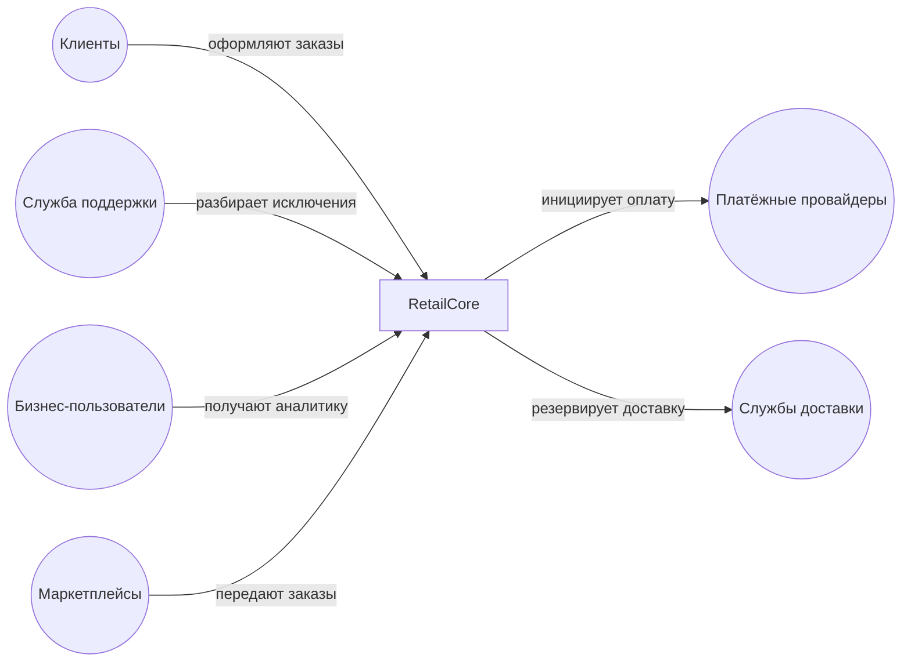

# Architecture Communication Canvas
*Система: Платформа RetailCore*

## Ценностное обоснование
* Ускорение вывода коммерческих изменений на рынок (time-to-market) за счет снижения связности компонентов и предсказуемости доработок.
* Обеспечение стабильности и устойчивости базового процесса оформления заказов (order flow), особенно в периоды пиковых нагрузок (распродажи).
* Снижение операционных затрат службы поддержки за счет внедрения прозрачной двухуровневой модели статусов и сокращения доли "ручных обходов".
* Формирование единой, доверенной картины данных по заказам во всех подразделениях (маркетинг, финансы, логистика).
* Создание масштабируемой базы для запуска новых каналов продаж и персонализированных партнерских сервисов.

## Ключевые функции
* Оформить заказ (выбор товаров, канала продаж, региона доставки).
* Рассчитать стоимость корзины с учетом скидок, региональных коэффициентов и акций.
* Проверить наличие товара и зарезервировать интервал доставки.
* Инициировать и подтвердить оплату заказа.
* Обеспечить управление жизненным циклом заказа (маршрутизация и обновление статусов).
* Предоставить прозрачную информацию о текущем статусе заказа клиенту и оператору поддержки.
* Передать информацию о заказах внешним логистическим партнерам и маркетплейсам.
* Сформировать данные для управленческой и финансовой аналитики.

## Ключевые заинтересованные стороны
* **Бизнес-спонсор (Стейкхолдер):** заказчик трансформации, ожидает предсказуемого TTM, роста выручки и единой картины данных.
* **Клиенты (Пользователи):** получают прозрачные статусы, точные сроки доставки и стабильный опыт оформления.
* **Служба клиентской поддержки (Пользователи):** нуждается в единой истории заказа, нормализованных статусах и автоматической маршрутизации исключений.
* **Бизнес-пользователи (Маркетинг, Финансы, Логистика):** используют аналитику и витрины данных для принятия управленческих решений.
* **Внутренние ИТ-команды и Эксплуатация (Технические участники):** осуществляют поддержку системы, задают ограничения по инфраструктуре (on-premise) и производительности.
* **Внешние партнеры (Маркетплейсы, Платёжные провайдеры, Службы доставки):** задают жесткие ограничения на форматы обмена данными, протоколы интеграций и SLA.

## Требования к качеству
* **Непрерывность (Availability):** поэтапный переход на новую архитектуру не должен приводить к остановке процессов продаж и обработки заказов. 
* **Наблюдаемость (Observability):** карточка заказа должна прозрачно отражать как понятный клиентский статус, так и детализированное внутреннее состояние с указанием причины отклонений.
* **Устойчивость (Resilience):** процесс оформления заказа (checkout) должен успешно завершаться даже при временной недоступности промо-сервисов или задержках логистических партнеров.
* **Согласованность данных (Consistency):** финансовая, маркетинговая и операционная аналитика должны базироваться на единой модели данных без расхождений.
* **Производительность (Performance):** время отклика при оформлении заказа не должно деградировать в пиковые периоды из-за блокировок в операционной базе данных.

## Деловой контекст

## Ключевые решения
* **[Legacy] Использование Java-монолита как универсального оркестратора:** Вся критичная бизнес-логика (расчет цены, статусы, маршрутизация) сосредоточена в одном месте, что снижает скорость разработки из-за пересечения модулей.
* **[Legacy] Oracle как универсальная шина и вычислитель:** База данных используется одновременно как операционное хранилище, место выполнения бизнес-логики (хранимые процедуры), шина обмена данными для партнерских сервисов (staging tables) и источник для аналитики.
* **[Legacy] Синхронные интеграции в процессе оформления:** Вызовы к внешним логистическим и платёжным провайдерам происходят синхронно в момент оформления, что делает платформу уязвимой к сбоям партнеров.
* **[Legacy] Отсутствие канонической модели данных:** Разные контуры (Python-скрипты, .NET-интеграции, BI) извлекают данные напрямую из БД, формируя "четыре реальности" одного заказа.
* **[Архитектурное ограничение] Ручные корректировки как штатный процесс:** Управление исключениями (например, зависшие статусы) решается административными ручными инструментами вместо платформенной оркестрации исключений.

## Технологии
* **Java:** монолитное ядро, обеспечивающее процессинг заказов.
* **Oracle Database:** единая критичная реляционная база данных (хранение, интеграция, процедуры).
* **.NET:** вспомогательные интеграционные сервисы для обмена данными с партнерами (через общие таблицы СУБД).
* **Python:** аналитические выгрузки и batch-задания.
* **On-premise инфраструктура:** физические серверы с ограниченными возможностями быстрой виртуализации и масштабирования.

## Составные части системы
* **Сервис оформления и обработки заказов** (оркестрация процесса покупки).
* **Сервис расчёта цен и промо** (управление правилами скидок и акций).
* **Сервис управления статусами** (жизненный цикл и технические состояния заказов).
* **Сервис платёжной оркестрации** (взаимодействие с провайдерами).
* **Сервис маршрутизации доставки** (выбор слотов и резервирование логистики).
* **Сервис партнерских интеграций** (обмен данными со смежными системами).
* **Сервис аналитики и витрин данных** (формирование управленческой отчетности).

## Риски и недостающая информация
* **Риск:** Изменения в критичном контуре checkout/payments могут привести к сбоям базового потока заказов. (Меры: feature flags, строгий rollback-план).
* **Риск:** Команды могут продолжать использовать "ручные обходы", игнорируя платформенные обновления, если новые решения не будут покрывать нестандартные исключения (split shipment, переадресация).
* **Риск:** Нехватка ресурсов текущей on-premise инфраструктуры для параллельной работы старого и нового контура во время миграции.

| Архитектурно значимый пробел | Почему важно | У кого уточнить |
|------------------------------|--------------|-----------------|
| Нет целевых значений RTO/RPO | Непонятно, сколько времени система может быть недоступна и допустима ли потеря транзакций заказа при переключении | Бизнес-спонсор, Эксплуатация |
| Нет SLA/SLO для клиентской поддержки | Невозможно установить пороговые метрики успешности новой архитектуры в части наблюдаемости статусов | Руководитель службы поддержки, Operations |
| Нет p95/p99 по времени оформления заказа | Невозможно проверить соответствие производительности нового контура checkout ожиданиям бизнеса | Бизнес-владелец, ИТ-команда |
| Нет правил деградации (логистика, платежи) | Непонятно, как именно система должна реагировать при недоступности внешних провайдеров (таймауты, fallback) | Бизнес-владелец, Операционный блок |
| Отсутствует точный реестр legacy-логики в Oracle | Есть риск потерять часть скрытых бизнес-правил при выносе расчетов скидок или маршрутизации из монолита | Технический лидер, Команда разработки |
