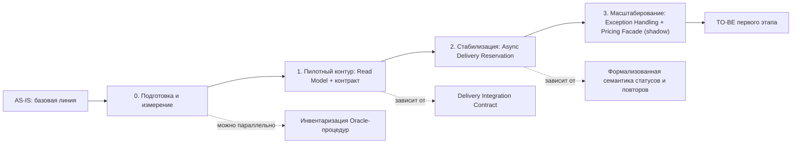

# migration-roadmap.md — roadmap инкрементальной миграции

> Roadmap описывает путь от AS-IS к целевому состоянию первого этапа трансформации платформы RetailCore, определённому в `transformation.md`.

## 0. Паспорт roadmap

| Поле | Значение                                                                                                                                                             |
|---|----------------------------------------------------------------------------------------------------------------------------------------------------------------------|
| Название проекта | Трансформация платформы RetailCore — первый этап                                                                                                                     |
| Связанный документ трансформации | `transformation.md`                                                                                                                                                  |
| Горизонт планирования | 3 квартала (первый управляемый этап трансформации, не финальная архитектура)                                                                                         |
| Выбранная стратегия миграции | Incremental Migration с элементами Parallel Run на рискованных переходах                                                                                             |
| Ключевые паттерны | Strangler Fig (промо-фасад), Event-Driven (Read Model статусов), Anti-Corruption Layer поверх Oracle/legacy-логики, Parallel Run / Shadow Mode для переключения цены |
| Автор | ФИО                                                                                                                                                                  |
| Дата | 26.08.2026                                                                                                                                                           |
| Версия | 1.0                                                                                                                                                                  |

## 1. Краткое резюме roadmap

Миграция выполняется инкрементально, потому что нельзя останавливать оформление заказов ради миграции, а ресурсы on-premise инфраструктуры ограничены для полноценного параллельного запуска старого и нового контуров сразу везде. Сначала команда строит слой чтения статусов заказа (Order Status Read Model), не трогая write-path checkout, и параллельно инвентаризирует legacy-логику Oracle. Затем на пилотном канале включается стандартизированный логистический контракт и асинхронное резервирование доставки. После стабилизации этого сценария внедряется автоматическая маршрутизация исключений и оба изменения расширяются на все каналы. Только после этого в shadow-режиме готовится и частично включается фасад расчёта цены и промо — самое рискованное изменение критичного пути. Порядок продиктован зависимостями: без слоя статусов не видно эффекта остальных изменений; без логистического контракта нельзя безопасно включить асинхронное резервирование; без формализованной семантики статусов и повторов нельзя доверить маршрутизацию исключений автоматике. Основные риски roadmap связаны с ограниченностью инфраструктуры для parallel run и отсутствием реестра legacy-правил в Oracle, поэтому для каждого этапа заданы критерии готовности и условия остановки.

## 2. Стартовое и целевое состояние

| Состояние | Описание | Ключевые ограничения | Метрики / признаки состояния                                                                                                        |
|---|---|---|-------------------------------------------------------------------------------------------------------------------------------------|
| AS-IS | Статусы разрозненены между монолитом, Oracle и admin-интерфейсами; checkout синхронно ждёт ответ логистического партнёра; обмен с .NET-сервисом идёт через staging-таблицы; цена/промо размазаны между кодом, PromoService и legacy-процедурами; исключения обрабатываются вручную | On-premise инфраструктура близка к пределу; монолит и Oracle — единственный источник правды | Baseline AHT (Average Handle Time) поддержки, число эскалаций, доля ручных корректировок, latency checkout — фиксируются на этапе 0 |
| Промежуточное состояние 1 (после этапов 0–1) | Order Status Read Model работает для пилотного канала (веб); часть логистического обмена переведена на явный контракт | Checkout всё ещё синхронно зависит от логистики; цена/промо не тронуты | Снижение AHT/эскалаций на пилотном канале; снижение инцидентов, связанных со staging-таблицами                                      |
| Промежуточное состояние 2 (после этапа 2) | Checkout на пилотном канале и партнёре не блокируется ответом логистики; статусы согласованы во всех представлениях | Автоматическая маршрутизация исключений ещё не включена; цена/промо legacy | p95/p99 latency checkout снижен на пилоте; доля успешных заказов при недоступности партнёра выросла                                 |
| TO-BE первого этапа (после этапа 3) | Read Model, логистический контракт и асинхронное резервирование работают на всех каналах; Exception Handling маршрутизирует исключения; фасад цены включён в shadow-режиме и частично — для отдельных промо-сценариев | Полный вынос checkout/оплаты из монолита, отказ от Oracle и унификация маркетплейсов — вне горизонта roadmap | Целевые значения AHT, эскалаций, доли ручных корректировок и TTM промо-инициатив — по метрикам этапов 0–3                           |

## 3. Roadmap миграции

| Этап | Цель | Промежуточное состояние | Основные работы                                                                                                                                                   | Зависимости | Риски | Критерии завершения |
|---|---|---|-------------------------------------------------------------------------------------------------------------------------------------------------------------------|---|---|---|
| AS-IS | Зафиксировать стартовую точку | Текущая разрозненная архитектура (см. as-is-analysis.md) | Baseline метрик, подтверждение архитектурного контекста                                                                                                           | — | Baseline неполон из-за пробелов в данных | Baseline подтверждён бизнесом и поддержкой |
| 0. Подготовка и измерение | Собрать данные для безопасного старта | Метрики и реестр legacy-логики готовы | Сбор baseline (AHT, эскалации, latency); инвентаризация Oracle-процедур и staging-потребителей; согласование open questions (RTO/RPO, MVP-каналы)                 | Baseline AS-IS | Реестр legacy-логики неполный | Baseline и реестр согласованы со стейкхолдерами |
| 1. Пилотный контур | Внедрить прозрачность и первый шаг логистического контракта | Order Status Read Model работает на пилотном канале; часть .NET-обмена — на контракте | Разработка Read Model; запуск Delivery Integration Contract для пилотного партнёра                                                                                | Этап 0 (метрики, реестр) | Расхождения между Read Model и legacy-источниками на старте | Read Model отдаёт согласованный статус на пилоте; часть staging-обмена заменена контрактом |
| 2. Стабилизация сценария | Отвязать checkout от синхронной логистики на пилоте | Асинхронное резервирование работает для пилотного канала/партнёра | Завершение перевода .NET-интеграции на контракт; включение Async Delivery Reservation через cutover (см. `cutover-plan.md`)                                       | Этап 1 (контракт, статусы) | Недоступность партнёра при неполном покрытии fallback-правил | p95/p99 checkout на пилоте снижен; нет роста дублей в очереди резервирования |
| 3. Расширение / масштабирование | Автоматизировать исключения и расширить охват | Exception Handling работает; Read Model и async-резервирование — на всех каналах; фасад цены — в shadow-режиме | Внедрение Exception Handling; распространение предыдущих этапов на маркетплейсы и мобильный канал; запуск Pricing & Promo Facade в shadow-режиме | Стабильность этапа 2 на пилоте | Рост оркестрационной сложности; расхождения в shadow-режиме фасада цены | Снижение ручных корректировок подтверждено на всех каналах; расхождения фасада цены в пределах порога |
| TO-BE первого этапа | Проверить достижение целевого состояния | Состояние по разделу 7 `transformation.md` | Финальная проверка метрик; частичное включение фасада цены для отдельных промо-сценариев                                                                          | Завершённые этапы 0–3 | Полный вынос checkout/оплаты и отказ от Oracle остаются нерешёнными (осознанно, вне горизонта) | Целевые метрики этапов достигнуты; решение о запуске следующего этапа программы принято бизнесом |

## 4. Детализация этапов

### Этап 0. Подготовка и измерение

| Раздел | Содержание |
|---|---|
| Цель этапа | Собрать baseline и данные, без которых остальные этапы небезопасны |
| Какие точки трансформации закрывает | Подготовительный, напрямую точку не закрывает |
| Что меняется в процессе | Ничего в production-поведении; добавляется сбор метрик |
| Что меняется в архитектуре | Инструментирование логирования/метрик для baseline |
| Что не меняется | Checkout, статусы, логистика, цена — без изменений |
| Входные условия | Согласие бизнеса на программу трансформации |
| Выходные условия | Baseline метрик и реестр legacy-логики готовы и согласованы |
| Метрики этапа | AHT, число эскалаций, p95/p99 checkout, доля ручных корректировок |
| Риски этапа | Реестр Oracle-логики может оказаться неполным |
| Условие остановки | Ключевые стейкхолдеры не согласовали baseline |

### Этап 1. Пилотный контур

| Раздел | Содержание |
|---|---|
| Цель этапа | Дать единый и согласованный статус заказа на пилотном канале |
| Какие точки трансформации закрывает | Точка 1 (Read Model статусов), начало точки 2 (логистический контракт) |
| Что меняется в процессе | Оператор поддержки и клиент на пилотном канале видят согласованный статус |
| Что меняется в архитектуре | Появляется Order Status Read Model; часть .NET-обмена переходит на Delivery Integration Contract |
| Что не меняется | Checkout остаётся синхронным; цена/промо не тронуты |
| Входные условия | Baseline и реестр из этапа 0 готовы |
| Выходные условия | Read Model отдаёт согласованный статус для пилотного канала |
| Метрики этапа | Снижение AHT и эскалаций на пилотном канале |
| Риски этапа | Расхождения между Read Model и legacy-источниками |
| Условие остановки | Расхождения статуса выше допустимого и не устраняются |

### Этап 2. Стабилизация сценария

| Раздел | Содержание |
|---|---|
| Цель этапа | Устранить блокировку checkout синхронным ответом логистики на пилоте |
| Какие точки трансформации закрывает | Точка 2 (завершение), точка 3 (Async Delivery Reservation) |
| Что меняется в процессе | Клиент пилотного канала получает подтверждение заказа мгновенно, слот доставки подтверждается отдельно |
| Что меняется в архитектуре | Async Delivery Reservation включается через cutover, описанный в `cutover-plan.md` |
| Что не меняется | Прочие каналы и партнёры остаются на синхронной схеме |
| Входные условия | Delivery Integration Contract работает стабильно (этап 1) |
| Выходные условия | Cutover пройден успешно, критерии стабилизации выполнены |
| Метрики этапа | p95/p99 checkout, доля успешных заказов при недоступности партнёра |
| Риски этапа | Недоступность партнёра при неполном fallback-покрытии |
| Условие остановки | Триггеры rollback из `cutover-plan.md` сработали |

### Этап 3. Расширение / масштабирование

| Раздел | Содержание                                                                                                              |
|---|-------------------------------------------------------------------------------------------------------------------------|
| Цель этапа | Автоматизировать обработку исключений и распространить изменения на все каналы                                          |
| Какие точки трансформации закрывает | Точка 4 (Exception Handling), начало точки 5 (Pricing & Promo Facade)                                                   |
| Что меняется в процессе | Поддержка получает готовые сценарии вместо ручных правок; охват точек 1–3 расширяется на маркетплейсы и мобильный канал |
| Что меняется в архитектуре | Появляется Exception Handling; Pricing & Promo Facade работает в shadow-режиме                                          |
| Что не меняется | Checkout не переключается на новый расчёт цены — только сравнение в shadow-режиме                                       |
| Входные условия | Этап 2 стабилен на пилоте не менее согласованного периода наблюдения                                                    |
| Выходные условия | Exception Handling обрабатывает согласованную долю исключений; расхождения фасада цены в shadow-режиме в пределах порога  |
| Метрики этапа | Снижение ручных корректировок на 1000 заказов; расхождения shadow-режима фасада цены                                    |
| Риски этапа | Рост оркестрационной сложности; неполный реестр legacy-правил цены                                                      |
| Условие остановки | Расхождения shadow-режима выше согласованного порога (порог — открытый вопрос, см. `transformation.md`)                 |

## 5. Зависимости между этапами

### 5.1. Таблица зависимостей

| Зависимость | Почему порядок жёсткий | Что будет, если нарушить порядок | Как контролируем |
|---|---|---|---|
| Этап 1 до этапа 2 | Async-резервирование должно публиковать статус через уже работающий логистический контракт | Асинхронный статус некуда будет отдавать согласованно — вернутся «четыре реальности» | Готовность контракта — входное условие этапа 2 |
| Этап 2 до этапа 3 (Exception Handling) | Автоматическая маршрутизация исключений опирается на формализованную семантику повторов, появляющуюся при async-резервировании | Exception Handling будет маршрутизировать по неполным/непроверенным правилам | Критерии стабилизации этапа 2 — входное условие этапа 3 |
| Инвентаризация Oracle-процедур можно параллельно с этапом 0/1 | Не блокирует Read Model и пилот логистики, но обязательна перед выносом цены | Нужно синхронизировать сроки готовности реестра к моменту старта точки 5 | Реестр — входное условие для начала работы над Pricing Facade |

## 6. Управление рисками roadmap

| Этап | Риск | Вероятность | Влияние | Контроль | Условие остановки | Владелец |
|---|---:|---:|---:|---|---|---|
| 0–1 | Ограниченные ресурсы on-premise не позволяют держать параллельно старый и новый контур даже на пилоте | Высокая | Высокое | Ограниченный scope пилота (один канал/партнёр), мониторинг нагрузки | Деградация production-показателей при включении пилота | Эксплуатация |
| 1 | Реестр legacy-логики Oracle неполон | Высокая | Высокое | Инвентаризация до выноса логики; регресс-тесты на исторических данных | Обнаружены неучтённые правила без возможности их верифицировать | Технический лидер |
| 2 | Async-резервирование снижает точность обещания срока доставки | Средняя | Среднее | Явная коммуникация клиенту о предварительном/подтверждённом слоте | Рост доли жалоб на срок доставки после включения | Продукт / поддержка |
| 3 | Команды продолжают ручные обходы параллельно с Exception Handling | Средняя | Среднее | Инвентаризация критичных workaround'ов и их приоритетная замена | Доля обходов в обход нового механизма превышает согласованный порог | Технический лидер |
| 3 | Расхождения в shadow-режиме Pricing Facade выше допустимых | Средняя | Высокое (финансовый риск) | Shadow-сравнение перед любым включением на реальном трафике | Расхождение выше порога (порог — открытый вопрос) | Архитектор / финансовый контроль |

## 7. Метрики и контрольные точки

| Контрольная точка | Когда проверяем | Что проверяем | Целевой порог | Источник данных | Решение по результату |
|---|---|---|---:|---|---|
| Готовность baseline | Конец этапа 0 | AHT, эскалации, p95/p99 checkout, доля ручных корректировок | Baseline зафиксирован и согласован | Дашборды поддержки и эксплуатации | Продолжить / уточнить у стейкхолдеров |
| Пилот Read Model | Конец этапа 1 | Расхождение статуса между Read Model и legacy-источниками | Порог согласуется с поддержкой | Сверка Read Model vs legacy | Продолжить / доработать модель |
| Cutover async-резервирования | Этап 2, по критериям `cutover-plan.md` | p95/p99 checkout, доля успешных заказов при сбое партнёра | См. `cutover-plan.md`, раздел 9 | Мониторинг checkout | Продолжить / ограничить трафик / откатить |
| Готовность shadow-режима Pricing Facade | Конец этапа 3 | Расхождение расчётов старого и нового контура | Порог — открытый вопрос (см. п. 11) | Логи shadow-сравнения | Готовить cutover / доработать / отложить |

## 8. Промежуточные состояния

| Промежуточное состояние | Что уже работает | Что ещё остаётся в легаси | Как пользователь видит сценарий | Как поддержка видит сценарий | Основные риски |
|---|---|---|---|---|---|
| После этапа 1 | Read Model статусов и часть логистического контракта на пилотном канале | Checkout синхронный; цена/промо legacy | Статус согласован на пилотном канале | Единая история заказа на пилоте, остальные каналы — как раньше | Расхождения статуса на границе Read Model и legacy |
| После этапа 2 | Async-резервирование доставки и полный контракт на пилоте | Исключения — вручную; цена/промо legacy; прочие каналы синхронны | Заказ на пилоте подтверждается мгновенно, слот — отдельно | Понятный статус «слот в подтверждении» вместо зависания | Неточность обещания срока доставки при недоступности партнёра |

## 9. Связь roadmap с cutover-планами

| Ключевой переход | На каком этапе | Почему нужен отдельный cutover-plan | Связанный файл |
|---|---|---|---|
| Переключение резервирования доставки при checkout с синхронного вызова на асинхронную схему | Этап 2. Стабилизация сценария | Меняет поведение критичного пути (checkout) для реального трафика; требует go/no-go, наблюдаемости и rollback | `cutover-plan.md` |

## 10. Открытые вопросы

| Вопрос | Почему важен | Кто должен ответить | Срок | Что делаем, если ответа нет |
|---|---|---|---|---|
| Целевые RTO/RPO, p95/p99 и допустимая деградация на переходе | Без них нельзя формально закрыть критерии этапов 2 и 3 | Технический лидер, эксплуатация | До старта этапа 2 | Используем консервативные внутренние пороги и явно фиксируем их как временные |
| Минимальный набор каналов для первого этапа | Определяет объём пилота этапа 1 | Бизнес-заказчик, руководитель поддержки | До старта этапа 1 | Пилот ограничивается одним веб-каналом по умолчанию |
| Допустимый порог расхождения shadow-режима Pricing Facade | Нужен как критерий готовности будущего cutover точки 5 | Бизнес-заказчик, финансовый контроль | До конца этапа 3 | Этап 3 завершается без включения фасада на реальном трафике, только в shadow-режиме |
